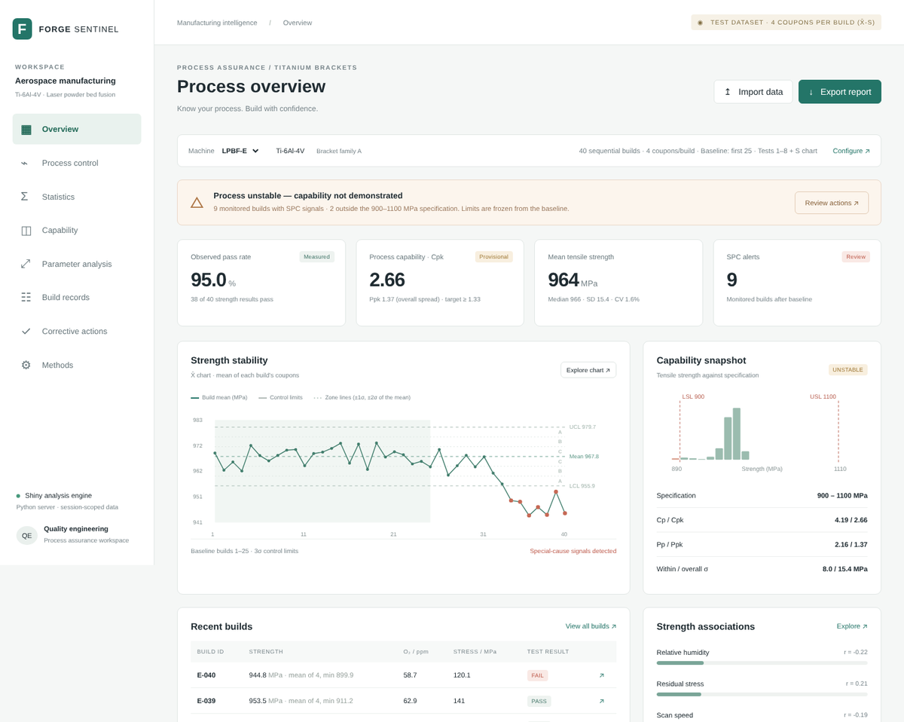
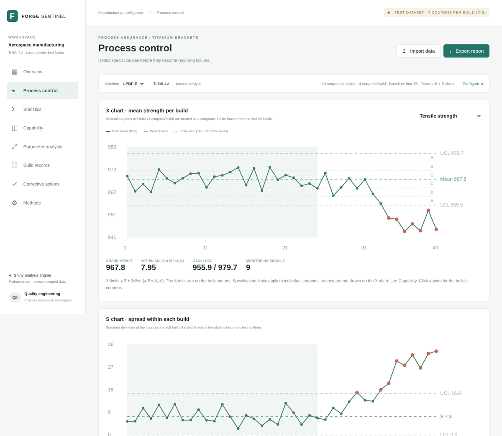
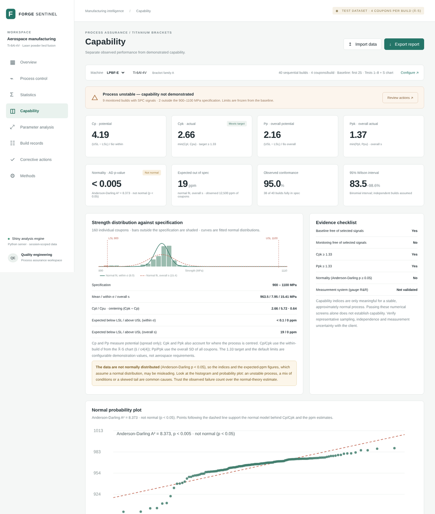

# Demonstration

This walkthrough uses the four test datasets in [`datasets/`](datasets/README.md) to show what Forge
Sentinel does for a contractor whose titanium brackets are failing client strength tests:

1. **Monitor:** is the printing process stable, and is it capable of meeting the specification?
2. **Flag:** when did it change, and which builds are affected?
3. **Help resolve:** which process condition is the likely cause, and what to do next?

Everything uses the default settings: LSL 900 MPa, USL 1100 MPa, Cpk target 1.33, baseline = first 25
builds, all 8 tests plus the moving-range rule.

## Reproduce it yourself

**In the dashboard** (locally with `shiny run app.py`, or on the deployed Posit Connect app): click
**Import data**, then pick one of the **Try a test dataset** buttons. To try Excel import, upload
`datasets/02_oxygen_drift.xlsx` instead; it gives the same results as the CSV.

**Without the dashboard:** run the same analysis from the command line (standard library only):

```
python demo/run_demo.py
```

The output is saved in [`demo/demo_output.txt`](demo/demo_output.txt). Every number quoted below comes
from it, and `tests/test_datasets.py` checks the key results automatically.

---

## Scenario 1 — A healthy process (`01_stable_capable.csv`)

*Question: if we're doing things right, does the tool say so?*


**What the tool shows (LPBF-A):**
- **Verdict:** *No SPC signals detected — qualification review required.* No strength build trips any
  of the 8 tests.
- **Capability:** Cpk **1.89** and Ppk **2.10**, both above the 1.33 target. Short-term (within) and
  overall spread agree (σ 12.05 vs s 10.87 MPa), as expected for a stable process.
- **Pass rate:** 50/50. The 95% Wilson interval is 92.9–100%: even with no failures, 50 tests can't
  prove a 100% pass rate.
- Switch the **Machine** selector to **LPBF-B**: also stable, Cpk 1.84, running about 10 MPa weaker on
  average. That's worth knowing, but it's not a problem.

**What it tells the contractor:** the process is stable and capable on both machines. The numbers
support a qualification review, but they don't replace one.

---

## Scenario 2 — Finding the cause of failures (`02_oxygen_drift.csv`)

*Question: parts started failing. When did the process change, and why?*

### Step 1 — The overview raises the alarm


- **Verdict:** *Process unstable — capability not demonstrated.* 13 monitored builds have special-cause
  signals, and 3 builds (C-056, C-057, C-060) are outside the 900–1100 MPa specification.
- The strength chart shows a clear dip in the middle of the run, followed by recovery.
- **Cpk 2.04 vs Ppk 0.95.** Cpk is calculated from the clean baseline (builds 1–25), so it reflects
  what the process *can* do. Ppk uses the overall spread, including the drift, so it shows what the
  process *actually* delivered. The card is labelled *Provisional* because capability means nothing
  for an unstable process.

### Step 2 — Process control pinpoints when


- The first strength signal is **build 49** (Test 1: beyond zone A, plus a moving-range jump).
- The **8-tests table** counts what fired: Test 1 = 11 points, Test 2 = 11, Test 3 = 9, Test 4 = 5,
  MR rule = 2. The **signal log** lists each flagged build with its reasons.
- The signals stop after build 61, which shows that whatever changed was fixed.

Now switch the variable selector to **Chamber oxygen**:


- Oxygen is flagged at **build 44** (Tests 1, 2 and 5), **5 builds before strength**. Had the
  contractor been watching oxygen, they could have stopped the machine before any failing parts were made.

### Step 3 — Parameter analysis points to why


- **Chamber oxygen** has by far the strongest association with strength (**r = −0.84**). The next is
  humidity at −0.22, which rose with the leak.
- **12 builds** exceeded the 100 ppm oxygen alarm.
- The scatter plot shows strength falling as oxygen rises. All three failing builds (red) are among the
  highest-oxygen builds (above 130 ppm).

### Step 4 — Capability, statistics and next steps


The **Capability** page sets out every index (Cp 3.31, Cpk 2.04, Pp 1.54, Ppk 0.95). The **distribution graph**
overlays two fitted normal curves on the strength histogram: a narrow one using within σ (what the process can do
when stable) and a wide one using overall s (what it actually delivered). The **normal probability plot** and the
**Anderson-Darling test** (A² = 3.03, p < 0.005) show the data are not normal, because the drift adds a low tail.
So the page warns that the indices and the normal-theory ppm estimate (about 2,190 ppm using overall s) should be
treated with caution. The evidence checklist shows the gaps: signals in the monitoring period, Ppk below target, and
normality not met.


The **Statistics** page shows the descriptive picture: mean 961.5 vs median 968.1 MPa (the drift
pulls the mean down), SD 21.60 MPa, CV 2.25%, range 96.2 MPa. Compare that with SD 10.9 and CV 1.12% in the
stable dataset, where the Anderson-Darling test passes (p = 0.37 on LPBF-A). Every variable gets a box plot, a
histogram with a fitted normal curve and a normal probability plot.

Finally, **Corrective actions** lists the response, starting with *Contain affected production* and
*Investigate chamber atmosphere* (check the oxygen sensor, purge logs, seals and gas flow). The engineer
records status and notes there.

### Step 5 — Share the findings

Click **Export report** and choose a format:


**PDF report** opens the printable report in a new tab with the print dialog. Choose **Save as PDF** to
get a 5-page summary to send to the client or a manager.


Page 1 has the verdict, key numbers and the I-MR charts (X̄-S charts for coupon data). Page 2 has the 8 tests
and the signal log. Page 3 covers capability: the distribution graph with both fitted normal curves, the
indices, the normality check with expected vs observed out-of-spec counts, the probability plot and the failing builds:


Page 4, **Where to look**, ranks process variables by their link to strength, so chamber oxygen comes first,
flagged 5 builds before strength. The report ends with descriptive statistics, corrective-action status and notes,
and the method and limitations.

**Excel workbook** downloads the same results as a workbook: a Summary sheet with a native Excel control chart, the full
build data with control limits and PASS/FAIL (failures shaded, filters on), and sheets for statistics,
capability, signals, associations and corrective actions. **JSON data** gives the same results in machine-readable form.

**What actually happened** (from the dataset design): a chamber seal began leaking at build 41 and was
replaced after build 60. The tool found the change, its timing and its cause from the data alone.

> Note: a few secondary variables (laser power, scan speed, residual stress) show isolated early
> signals. With 7 variables × 8 tests, occasional false alarms are expected, so the engineer should
> look for patterns that line up with strength.

---

## Scenario 3 — Minimal data, early warning (`03_strength_only.csv`)

*Question: what if the contractor only records strength?*


- The file has only `id`, `machine` and `strength`. The tool still produces control charts, the 8 tests,
  descriptive statistics and capability indices.
- A mean shift is caught at **build 36**, the first build after the change (Test 1 plus a moving-range
  jump). Tests 2, 3 and 4 confirm it over the next few builds.
- **No part has failed yet** (60/60 pass), but **Ppk is 0.64**: at the new level, failures are coming.
  The tool gives the warning before the client's acceptance tests would.
- **Parameter analysis** explains that only strength was provided and suggests which process columns to
  record next, so the contractor can find the cause next time.

**What actually happened:** a new powder lot was introduced at build 36 and lowered mean strength by
about 46 MPa.

---

## Scenario 4 — Several coupons per build: X̄ and S charts (`04_coupon_spread.csv`)

*Question: we test four coupons from every build. Can the tool use all of them?*

The file has one row per coupon, with a `coupon` column holding the plate position (P1–P4). The tool detects
this and treats each build's four coupons as a **subgroup**.



- The filter bar shows *40 sequential builds · 4 coupons/build · Tests 1–8 + S chart*, and the overview's stability
  chart is now an **X̄ chart** (mean strength per build).



- **Process control** shows the **X̄ chart** (build averages; limits x̿ ± A₃·s̄ = 955.9–979.7 MPa) and the
  **S chart** (spread of the four coupons in each build; UCL = B₄·s̄ = 16.60 MPa).
- The **S chart flags first, at build 30**: coupons on the same plate are drifting apart. The X̄ chart doesn't
  flag until **build 34**. An I-MR chart of build averages would also wait until build 34, so recording every
  coupon buys **4 builds of extra warning**.
- Click a flagged build to see its coupons. In late builds P4 is far below P1 and P2, which points to a
  position-dependent cause such as gas flow across the plate rather than a whole-build cause such as powder or oxygen.
- Builds **E-037** and **E-040** each have a P4 coupon below 900 MPa, so they fail, even though their *averages*
  pass.



- **Capability** now uses the within-build σ̂ = s̄ / c₄(4) = 7.95 MPa (Cp 4.19, Cpk 2.66) and the overall SD of all
  160 coupons (Pp 2.16, Ppk 1.37).
- **The distribution check changes the conclusion.** The 160 coupon strengths are clearly not normal (Anderson-Darling
  A² = 8.37, p < 0.005); the probability plot curves away at the low end. A normal fit predicts only about
  **19 ppm** out of spec, but the observed rate is **2 of 160 coupons (12,500 ppm)**. The page flags this and tells
  the engineer to trust the observed failures over the normal-theory estimate.

**What actually happened:** from build 26 the argon flow across the plate degraded, so coupons far from the inlet
(P4, and P3 less so) lost strength build after build.

---

## Command-line demo

The same engine works without the dashboard, for example in a nightly job:

```
$ python python/analyze.py datasets/02_oxygen_drift.csv --machine LPBF-C --usl 1100
{
  "n": 70,
  "mean": 961.54...,
  "Cp": 3.31..., "Cpk": 2.04..., "Pp": 1.54..., "Ppk": 0.95...,
  "failed_strength_tests": 3,
  "tests_applied": [1, 2, 3, 4, 5, 6, 7, 8, "MR"],
  "signals": [{"build": "C-049", "phase": "monitoring", "tests": [1, "MR"], ...}, ...],
  "stable_under_selected_rules": false,
  "capability_screen_passed": false,
  ...
}
```

(Output shortened; the full JSON also includes descriptive statistics, the pass rate and the Wilson interval.)

## About the screenshots

The screenshots were captured from the app's rendered pages at 1440 px wide with the test datasets loaded,
then scaled to 1200 px. Fonts may differ slightly from the live app.
